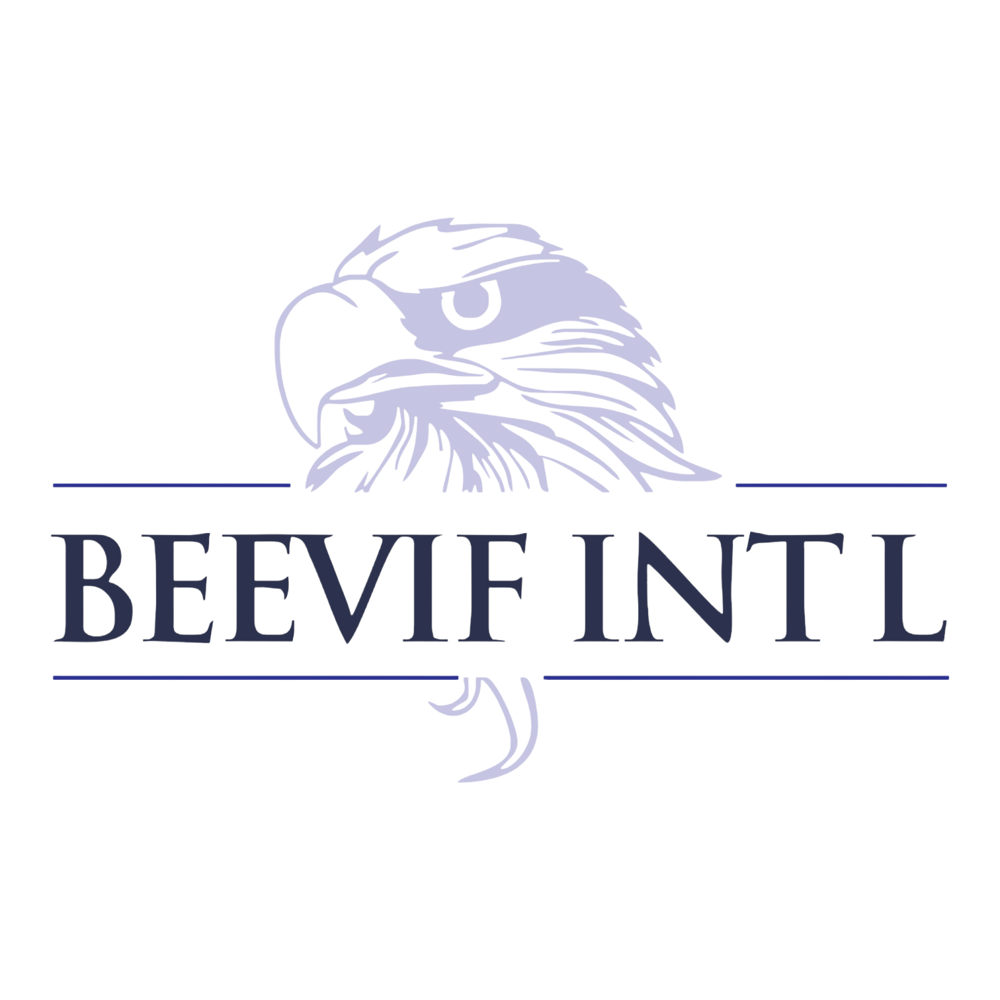

<div align="center">



# Nestling 2Innovate (N2I)

**Equipping young Ghanaians with STEM, digital, and AI skills so that geography never determines opportunity.**

[](https://nestling2innovate.org/)


[Live Site](https://nestling2innovate.org/) · [About N2I](#about-n2i) · [Getting Started](#getting-started) · [Updating Content](#updating-content)

</div>

---

## Table of Contents

- [About N2I](#about-n2i)
- [Features](#features)
- [Tech Stack](#tech-stack)
- [Getting Started](#getting-started)
- [Project Structure](#project-structure)
- [Routes](#routes)
- [Updating Content](#updating-content)
- [Design](#design)
- [Deployment](#deployment)
- [Contributing](#contributing)
- [Roadmap](#roadmap)
- [Author](#author)

---

## About N2I

**Nestling 2Innovate (N2I)** is the flagship initiative of the **Baiden Etsiakoh Eagle Vision Foundation (BEEVIF)**, a Ghana-registered charitable foundation based in Tantra Hills, Accra.

> **Mission:** To equip school-age children and out-of-school youth in under-resourced Ghanaian communities with the STEM, digital, and AI skills they need to compete and thrive, regardless of their starting point.
>
> **Vision:** A permanent Community STEM Innovation Centre anchored in Accra, extending a structured skills pipeline into rural communities where internet access remains a barrier.

Learners progress along the **Nestling → Fledgling → Eagle** pathway through four programmes:

| Programme | Focus |
| --- | --- |
| 🌐 **Web Design** | Building and designing websites from scratch |
| 💻 **Programming** | Core programming and problem-solving skills |
| 🤖 **AI Literacy** | Understanding and using AI tools responsibly |
| 🌍 **Global Virtual Internships** | Real-world experience with international partners |

**Impact so far:** 18 learners served across 4 proof-of-concept programmes.

This website introduces N2I to learners, parents, volunteers, partners, and donors. It explains the programmes, profiles the team, shares learner stories, and guides visitors to apply, volunteer, partner, or donate.

---

## Features

- 📄 **Seven pages:** Home, About, Programs, Get Involved, Impact, Team, and individual news stories
- 👥 **Data-driven team profiles:** each member is one object in an array, and the Team page renders every profile from it
- 🔗 **Deep links:** About page team cards link straight to each person's full profile (`/team#member-id`)
- 📰 **News stories:** a dynamic `/news/:slug` route for learner and partner stories
- ✨ **Motion:** scroll-triggered reveals, hero slideshows, typewriter headings, animated stat counters, a marquee, and confetti on tab transitions
- 📱 **Responsive:** designed and tested for mobile, tablet, and desktop
- ⚡ **Fast and static:** no backend, so it can be hosted anywhere and loads quickly

---

## Tech Stack

| Tool | Purpose |
| --- | --- |
| [React 18](https://react.dev) | UI library |
| [React Router 6](https://reactrouter.com) | Client-side routing |
| [Vite 5](https://vitejs.dev) | Dev server and build tool |
| [canvas-confetti](https://github.com/catdad/canvas-confetti) | Celebratory confetti effects |
| Plain CSS | All styling lives in `src/styles.css` |

There is no backend or CMS. All content lives directly in the page components.

---

## Getting Started

### Prerequisites

- [Node.js](https://nodejs.org) 18 or later
- npm (included with Node.js)

### Installation

```bash
# Clone the repository
git clone https://github.com/AdikaNathaniel/Nestling2Innovate-Website.git
cd Nestling2Innovate-Website

# Install dependencies
npm install

# Start the dev server at http://localhost:5173
npm run dev
```

### Available Scripts

| Command | Description |
| --- | --- |
| `npm run dev` | Start the development server with hot reload |
| `npm run build` | Build for production into `dist/` |
| `npm run preview` | Preview the production build locally |

---

## Project Structure

```
├── public/
│   ├── images/          # Photography used across the site
│   ├── news/            # Images for news stories
│   ├── team/            # Team headshots served on the site
│   └── logo.png         # BEEVIF logo
├── src/
│   ├── components/      # Header, Footer, Reveal, HeroSlideshow, Marquee,
│   │                    # StatNumber, TabTransition, TypewriterHeading, ScrollToTopButton
│   ├── hooks/           # useReveal, useCountUp, useTypewriter
│   ├── pages/           # Home, About, Programs, GetInvolved, Impact, Team, NewsStory
│   ├── App.jsx          # Routes and layout shell
│   ├── main.jsx         # App entry point
│   └── styles.css       # Global stylesheet
├── docs/                # Product specification
├── index.html
├── vercel.json          # SPA rewrites for Vercel
└── vite.config.js
```

---

## Routes

| Path | Page | Sections |
| --- | --- | --- |
| `/` | Home | Hero, impact stats, programme highlights |
| `/about` | About | Our Story, Our Team, Mission & Vision |
| `/programs` | Programs | Web Design, Global Virtual Internships, Programming, AI Literacy, Community STEM Innovation Centre |
| `/get-involved` | Get Involved | Apply/Enrol, Volunteer & Mentor, Partner With Us, Donate |
| `/impact` | Impact | Our Impact, Success Stories, News & Updates |
| `/team` | Team | Full profile for each team member |
| `/news/:slug` | News Story | Individual story pages |

---

## Updating Content

All content lives in the page components, so updates are a matter of editing JavaScript objects and JSX.

### Adding a team member

1. Add the headshot to `public/team/`, using a lowercase, hyphenated filename (for example `jane-doe.jpeg`).
2. In `src/pages/Team.jsx`, add an entry to the team array:

   ```js
   {
     id: 'jane-doe',
     name: 'Jane Doe',
     role: 'Role Title',
     image: '/team/jane-doe.jpeg',
     background: 'Education and experience…',
     function: 'What they do at N2I…',
     // imagePosition: 'center top', // optional: adjust the photo crop
   },
   ```

3. In `src/pages/About.jsx`, add a card to the "Our Team" grid:

   ```jsx
   <Reveal variant="drop" delay={1.92} className="team-card">
     <Link to="/team#jane-doe">
       
     </Link>
     <h3>Jane Doe</h3>
     <div className="role">Role Title</div>
   </Reveal>
   ```

   Give each new card a `delay` 0.12 higher than the previous card, so the cards keep animating in one after another.

### Adding a news story

1. Add the story's images to `public/news/`.
2. Add an entry to the `STORIES` object in `src/pages/NewsStory.jsx`. The object key becomes the URL slug, so `'jane-doe': { … }` is served at `/news/jane-doe`.

### Updating impact numbers

The stat counters on the Home and Impact pages use `<StatNumber target={…} />`. Change the `target` value in `src/pages/Home.jsx` and `src/pages/Impact.jsx`.

---

## Design

| Aspect | Approach |
| --- | --- |
| **Palette** | Cyan blue (`#0097b2` / `#00b4d8`) and white, as set out in `docs/N2I-Product-Specification.pdf` |
| **Animation** | Native `IntersectionObserver` and CSS `@keyframes`, with no animation library |
| **Imagery** | N2I's own photography, plus stock images from Pexels (free for commercial use) |
| **Accessibility** | Alt text on images and ARIA labels on icon links |

---

## Deployment

The site is deployed on **Vercel** at [nestling2innovate.org](https://nestling2innovate.org/).

`vercel.json` rewrites every path to `index.html`, so client-side routes like `/team` and `/news/:slug` still work when the page is refreshed:

```json
{
  "rewrites": [{ "source": "/(.*)", "destination": "/index.html" }]
}
```

`npm run build` produces a static `dist/` folder, which can also be deployed to any static host (Netlify, GitHub Pages, and so on). No environment variables are needed.

---

## Contributing

1. Create a branch: `git checkout -b feat/your-change`
2. Make your changes and check them locally with `npm run dev`
3. Make sure the production build passes: `npm run build`
4. Commit with a clear message, for example `feat: added new team member`
5. Push and open a pull request

---

## Roadmap

- [ ] Link the footer's social media icons (Facebook, Instagram, LinkedIn, X), which currently point to `#`
- [ ] Add photos of the Community STEM Innovation Centre once it is built
- [ ] Add more learner success stories as cohorts graduate

---

## Author

Built and maintained by **[Nathaniel Adika](https://github.com/AdikaNathaniel)**, volunteer digital skills trainer at N2I.

<div align="center">

Made with ❤️ for the young innovators of Ghana

</div>
